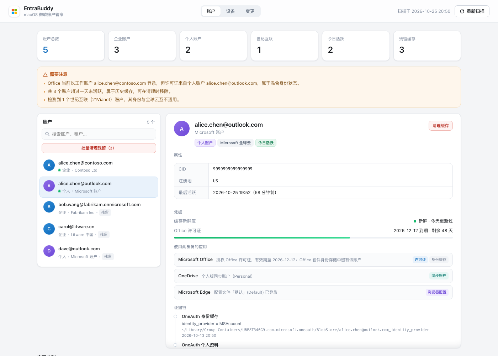
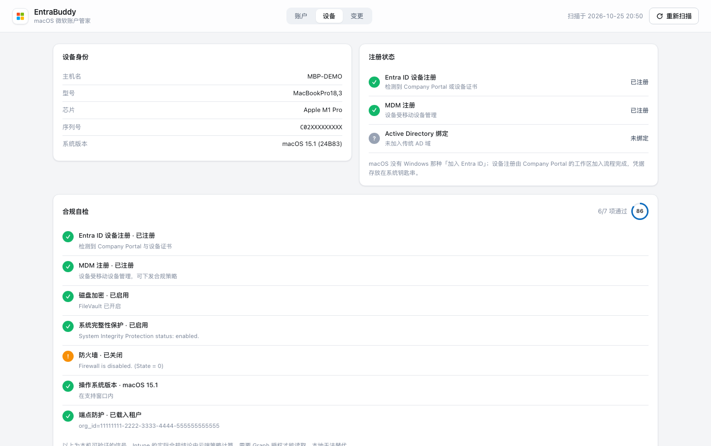
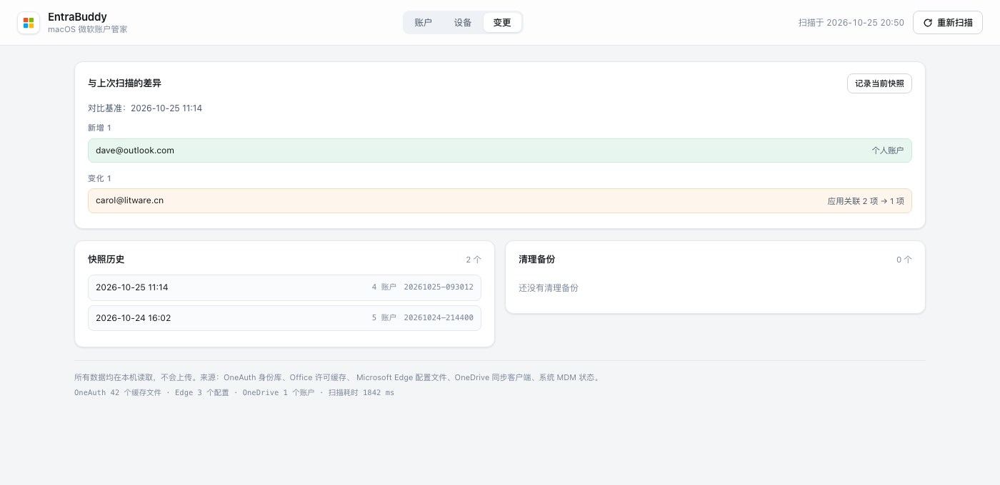

<div align="center">

# EntraBuddy

**macOS 上排查 Microsoft Entra ID 身份问题的本地工具**

看清这台 Mac 到底登录了哪些微软账户、被哪些应用持有、注册到了哪个租户。

[](#)
[](#)
[](#)
[](LICENSE)



</div>

## 它解决什么问题

排查 Entra ID 相关的登录问题时，最费时间的往往不是修复，而是**搞清楚现状**：

- Office 一直弹登录框，可明明已经登录了——到底是哪个账户在生效？
- 这台机器到底注册到哪个租户了？为什么 Intune 推不下来策略？
- 换过公司之后，旧的租户身份是不是还留在本地？
- 用户说是「用公司账号登录的」，但许可证为什么显示是个人订阅？

macOS 把答案分散在 OneAuth 身份库、Office 许可缓存、Edge 配置文件、OneDrive 偏好、系统 MDM 状态等十几个位置，而且大多是二进制或加密的。

EntraBuddy 把这些信息汇总成一张可读的视图，并且**只读本地文件、不碰任何凭据**。

## 功能

### 账户清点

区分企业账户（OrgId）与个人账户（MSA），识别国际版与世纪互联（21Vianet）云，展示租户名、租户 ID、对象 ID、CID 与最后活跃时间。


### 应用关联

回答「谁在用它、以什么身份用」。每个账户会标注它在各应用中的角色：

| 角色 | 含义 |
|------|------|
| 当前登录 | 应用正在使用的身份 |
| 许可证 | 授权该应用订阅的账户 |
| 同步账户 | OneDrive 等同步客户端绑定 |
| 浏览器配置 | Edge 配置文件登录态 |
| 身份缓存 | 仅存在于本地缓存，未在使用 |
| 设备策略 | 与 MDM / 端点防护关联 |

这一步经常能直接定位问题：**Office 以工作账户登录、许可证却来自个人订阅**，就是典型的混合身份故障。

### 设备与合规自检



设备身份、Entra ID 注册状态、MDM 注册、传统 AD 绑定，外加七项本地可验证的合规信号（FileVault / SIP / 防火墙 / 系统版本 / 端点防护等）。

严格区分「不合规」与「无法判定」——读不到就明说读不到，不猜。

### 变更追踪



每次扫描自动记录快照，对比出新增、消失、变化的账户。排查「昨天还好好的」这类问题时特别有用。

### 备份式清理

残留的身份缓存可以清理，但**先备份再删**：文件复制到 `~/Library/Application Support/EntraBuddy/backups` 并逐个校验大小，任一失败整体中止。支持单账户与批量，可一键回滚。

## 快速开始

### 下载预编译版（Apple Silicon）

从 [Releases](https://github.com/ituff/EntraBuddy/releases) 下载最新的 `EntraBuddy-*-macos-arm64.zip`，解压后把 `EntraBuddy.app` 拖进「应用程序」。

应用已内置 Python 运行时与 PyObjC，**不需要预装任何东西**。

首次打开会被 Gatekeeper 拦下（应用未签名公证），二选一：

- 右键点击应用 → 打开 → 再点「打开」
- 或执行 `xattr -dr com.apple.quarantine /Applications/EntraBuddy.app`

### 从源码构建

```bash
git clone https://github.com/ituff/EntraBuddy.git
cd EntraBuddy
./desktop/build_app.sh
open dist/EntraBuddy.app
```

构建脚本会把 Python 运行时和 PyObjC 一起打包进 `Contents/Resources`，产出的 `.app` 可以拷到任意机器运行（架构需一致）。

原生窗口（PyObjC + WKWebView），启动时自动拉起本地服务并分配随机端口，退出时自动关闭。

### 浏览器模式

```bash
./run.sh                 # http://127.0.0.1:8765
./run.sh --port 9000
```

后端零第三方依赖，只用 Python 标准库。

### 演示模式

想先看看界面，或者给同事演示：

```bash
./run.sh --demo
```

用虚构账户渲染完整界面，所有写操作自动禁用。

## 工作原理

| 来源 | 路径 | 提供的信息 |
|------|------|-----------|
| OneAuth 身份库 | `~/Library/Group Containers/UBF8T346G9.com.microsoft.oneauth/BlobStore/` | UPN、账户类型、租户名、objectId、CID |
| 主域发现缓存 | 同上 `*_hrd` | 云环境（Global / China）、tenantId |
| Office 偏好 | `defaults read com.microsoft.office` | 当前登录身份、授权邮箱 |
| Office 许可证 | `~/Library/Group Containers/UBF8T346G9.Office/Licenses/` | 授权账户 CID、有效期 |
| Edge | `~/Library/Application Support/Microsoft Edge/` | 各配置文件的登录账户 |
| OneDrive | `UBF8T346G9.OneDriveSyncClientSuite.plist` | 同步账户、个人版 / 企业版 |
| 系统 | `profiles`、`fdesetup`、`csrutil`、`socketfilterfw` | MDM、加密、SIP、防火墙 |

### 两个关键发现

**OrgId 账户的 objectId 推断。** OneAuth 的 blob 前缀对 OrgId 账户是用户的 `objectId`，不是 `tenantId`，而且没有 UPN → objectId 的映射表。

第一版按时间戳邻近做贪心匹配，结果把两个账户的租户配反了——时间相邻纯属巧合。后来改用「租户显示名 ↔ 邮箱域名」归一化匹配（`Fabrikam Inc` ↔ `fabrikam.com`），时间戳只做平局裁决，并输出置信度。

**MSA 的三种 ID 是同一个值。** OneAuth accountId = Edge `gaia_id` = OneDrive `cid`（16 位 hex），可以互相交叉验证。

## 安全与隐私

- **不读取凭据。** 令牌缓存是加密的，工具只解析账户元数据，不接触 access token / refresh token
- **不出网。** 服务只监听 `127.0.0.1`，没有任何远程请求
- **写操作有护栏。** 需要自定义请求头（跨站请求无法伪造），清理前强制备份并校验，清单变化则要求重新确认
- **清理范围受限。** 只在 OneAuth 目录内、只匹配该账户的白名单前缀、拒绝符号链接与路径穿越

## 适用与不适用

**适合**

- 排查 macOS 上 Office / Teams / Edge / OneDrive 的账户身份混乱
- 确认设备是否注册到 Entra ID、是否受 MDM 管理
- 清理离职或换租户后残留的身份缓存

**不适合**

- 读取或导出令牌内容（设计上就不做）
- 替代 Intune 的合规判定（那需要 Graph 授权）
- Windows 端排查（本项目只针对 macOS 的存储结构）

## 开发

```
app.py                    HTTP 服务、路由、写操作护栏
desktop.py                PyObjC 桌面壳
entrabuddy/
  scan.py                 编排：合并来源、建立关联、生成洞察
  cleanup.py              备份 / 删除 / 回滚
  snapshots.py            快照与 diff
  demo.py                 演示数据
  collectors/
    oneauth.py            OneAuth 身份库（核心）
    office.py             Office 登录身份与许可证 JWT
    edge.py               Edge 配置文件
    onedrive.py           OneDrive 同步账户
    environment.py        已装应用 / MDM / Defender
    device.py             设备身份、注册状态、合规信号
web/                      GUI（原生 JS，无构建步骤）
tests/                    清理流程隔离测试
```

```bash
python tests/test_cleanup.py
```

测试在临时目录里跑完整的 计划 → 备份 → 删除 → 恢复，覆盖单账户与批量两条路径。

## 路线图

- [ ] 令牌细节：解析可读 JWT 声明，展示实际过期时间
- [ ] Graph 集成：读取真实的 Intune 合规结论与设备对象
- [ ] 导出：账户与应用关联导出为 CSV / JSON，便于审计留档
- [ ] 签名与公证：让 `.app` 可以直接分发

## 许可

[MIT](LICENSE)

---

<div align="center">
<sub>本项目与 Microsoft 无关联，未获其背书。Microsoft、Entra ID、Microsoft 365 是 Microsoft Corporation 的商标。</sub>
</div>
